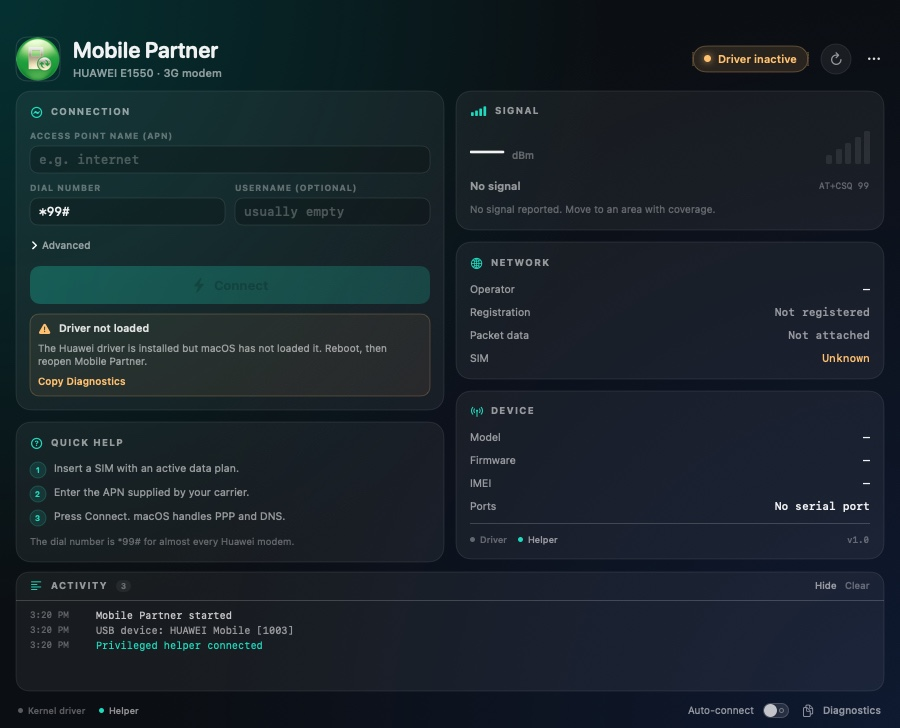

# Mobile Partner for Huawei E1550 on macOS 13

A native, 64-bit replacement for Huawei's 2013 **Mobile Partner** application,
built for the **Huawei E1550** 3G modem on **macOS 13 (Intel)**.

The original software cannot run on macOS 13 at all: its launcher is i386/PPC
and the whole Qt interface is 32-bit. This project keeps the part that still
works — Huawei's 64-bit kernel driver — and replaces the dead interface with a
small SwiftUI app that talks to the modem, configures the APN, and brings up a
real macOS PPP connection.



> The screenshot shows the state before the first reboot: the modem is detected,
> the helper is connected, and the driver is staged but not yet loaded.

---

## What works

- **Live modem telemetry** over AT commands
  - signal strength (RSSI/dBm), operator name, network registration, packet
    attachment, SIM state
  - modem model, firmware, IMEI
- **Native macOS PPP dial-up** through SystemConfiguration / `PPPController`
  - creates and manages a network service named **Mobile Partner**
  - uses the original Huawei modem script and `*99#`
  - shows the assigned IP address, session uptime and byte counters
- **APN configuration**
  - writes `AT+CGDCONT=1,"IP","<apn>"` to the modem
  - optional PAP/CHAP username and password
- **Connection management**
  - connect / disconnect, optional auto-connect
  - "Remove PPP Service" to rebuild a broken service
  - "Switch to Modem Mode" for modems stuck in CD-ROM mode (`12d1:1446`)
- **Diagnostics**
  - live activity log, one-click copyable diagnostic report
- **Privileged helper**
  - a small root LaunchDaemon handles network preferences and PPP, so the app
    does not need to run as root and does not prompt for a password each time.

## Requirements

| | |
|---|---|
| Mac | Intel (`x86_64`) |
| macOS | 13.x — tested on 13.7.1 (22H221) |
| Modem | Huawei E1550 (other Huawei modems handled by the same driver may work) |
| SIM | Active data plan and the carrier's APN |
| Access | Administrator account (installer and helper) |

The kernel extension is `x86_64` only. This project **does not work on Apple
Silicon Macs**. macOS 14/15 are untested; Apple continues to restrict third-party
kernel extensions.

## Install

### Option A — prebuilt package

1. Download `Mobile Partner.dmg` (or `Install Mobile Partner.pkg`) from the
   [Releases](../../releases) page.
2. Open the disk image and run **Install Mobile Partner.pkg**.
3. **Reboot.** macOS 13 stages third-party kernel extensions for the next boot.
   The modem serial ports do not exist before the restart.
4. After rebooting, open **Mobile Partner** from `/Applications`.

If macOS blocks the kernel extension, see
[Kernel extension troubleshooting](#kernel-extension-troubleshooting).

### Option B — build from source

Requirements: macOS 13 with Xcode Command Line Tools (Swift 5.9 was used).

```sh
git clone https://github.com/Alisina7/mobile-partner-huawei-modem-macos13.git
cd mobile-partner-huawei-modem-macos13
./build.sh
```

Outputs:

```
build/Mobile Partner.app
build/Install Mobile Partner.pkg
build/Mobile Partner.dmg
```

Then install the package and reboot as above.

> The package and app are ad-hoc signed, not notarized. If Gatekeeper complains,
> right-click the package and choose **Open**, or run:
>
> ```sh
> xattr -dr com.apple.quarantine "Install Mobile Partner.pkg"
> ```

## First connection

1. Insert a SIM with an active data plan.
2. Open **Mobile Partner**. The driver badge should read **Driver active** and
   the SIM state should become **Ready**.
3. Enter the **APN** supplied by your carrier (for example `internet`, `web`, or
   `3gnet` — it varies by carrier).
4. Leave the dial number at `*99#` unless your carrier says otherwise.
5. Press **Connect**. The first connection can take 10–20 seconds while PPP
   negotiates.
6. When connected, the app shows the assigned IP, uptime and traffic counters.
   The Mac now uses the modem as its internet connection.

> Mobile data may be charged by your carrier. Disconnect in the app when you are
> done.

## Kernel extension troubleshooting

Check whether the driver is loaded and the serial ports exist:

```sh
kmutil showloaded | grep -i huawei
ls /dev/cu.*HUAWEI*
```

You want two ports:

```
/dev/cu.HUAWEIMobile-Modem
/dev/cu.HUAWEIMobile-Pcui
```

If they are missing after a reboot:

1. Open **System Settings → Privacy & Security** and look for a blocked software
   message from **HUAWEI DEVICE USA INC.** — allow it, then reboot.
2. If approval is not offered, try loading it manually:

   ```sh
   sudo kmutil load --bundle-path /Library/Extensions/HuaweiDataCardDriver_10_9.kext
   ```

   A "requires a reboot" message is normal on the first load.
3. The driver has an old version-1 signature. On some systems macOS will only
   load it with reduced security (Recovery → Startup Security Utility) or with
   SIP/kext signing relaxed. This is a limitation of the 2013 binary, not of the
   replacement app.
4. Check the install log and the system log:

   ```sh
   cat /var/log/mobilepartner-install.log
   sudo dmesg | grep -i -E 'huawei|usb'
   ```

If the modem is detected as `12d1:1446` (CD-ROM installer mode), the app offers
**Switch to Modem Mode**. A working E1550 enumerates as `12d1:1003` (or
`12d1:14ac`) and exposes the two serial ports above.

## How it works

```
┌─────────────────────┐        Unix socket         ┌──────────────────────────┐
│ Mobile Partner.app  │  /var/run/mobilepartner.sock │ mphelper (root daemon)   │
│ (SwiftUI, user)     │ ──────────────────────────▶ │ SystemConfiguration APIs │
└─────────┬───────────┘                             └────────────┬─────────────┘
          │ AT commands                                          │ PPP service
          ▼                                                      ▼
 /dev/cu.HUAWEIMobile-Pcui                          /dev/cu.HUAWEIMobile-Modem
          │                                                      │
          └──────────────── Huawei E1550 ────────────────────────┘
                                 │
                                 ▼
                       macOS PPPController → carrier
```

1. The 64-bit Huawei kext creates two serial interfaces: a PCUI port for AT
   commands and a modem port for PPP.
2. The app polls the PCUI port for signal, registration, SIM and identity data,
   and writes the APN with `AT+CGDCONT`.
3. The helper creates (or updates) a macOS network service named **Mobile
   Partner**, layering PPP over the modem interface and selecting the original
   **HUAWEI Mobile Connect - 3G Modem** script.
4. `SCNetworkConnectionStart` hands dialing to macOS `PPPController`, which
   dials `*99#` and negotiates IPCP.
5. The app reads the assigned address from the SystemConfiguration dynamic store
   and polls connection statistics.

The modem port is never opened by the app while PPP is active, so status polling
does not disturb the data link.

## Repository layout

```
src/                    Swift sources for the app
  ATSerial.swift        termios-based AT command engine
  Telemetry.swift       AT polling and parsing
  HardwareProbe.swift   IOKit USB / driver / serial-port detection
  HelperClient.swift    Unix-socket JSON client
  ModemModel.swift      app state, connection and diagnostics
  Views.swift           SwiftUI interface
  App.swift             app entry point
src/Helper/main.swift   privileged root daemon
scripts/                installer preinstall / postinstall
installer/              Distribution XML, welcome and conclusion pages
payload/                LaunchDaemon plist
payloads/driver/        64-bit Huawei kernel extension
payloads/modem-script/  Huawei PPP modem script
resources/              app icon and modem activation tool
docs/                   screenshots
build.sh                builds the app, helper, package and DMG
Uninstall Mobile Partner.command
```

## Files installed

| Path | Purpose |
|---|---|
| `/Applications/Mobile Partner.app` | Native app |
| `/Library/Extensions/HuaweiDataCardDriver_10_9.kext` | 64-bit Huawei driver |
| `/Library/Modem Scripts/HUAWEI Mobile Connect - 3G Modem` | PPP dial script |
| `/Library/LaunchDaemons/com.mobilepartner.helper.plist` | Helper daemon |
| `/usr/local/mobilepartner/mphelper` | Helper binary |
| `/usr/local/mobilepartner/MBBActivateApp` | Huawei modem-mode switch |
| `/var/log/mobilepartner.log` | Helper log |
| `/var/log/mobilepartner-install.log` | Installer log |

## Troubleshooting

### The app says "Driver inactive"

The driver is installed but not loaded, or the modem is in the wrong USB mode.
See [Kernel extension troubleshooting](#kernel-extension-troubleshooting) and
check that the app sees `HUAWEI Mobile [1003]` in the Device card.

### "No serial port" but the driver is loaded

Unplug the modem, wait a few seconds, reconnect it, then press Refresh. Avoid
charge-only cables and unpowered hubs.

### Connection fails or drops immediately

- Confirm the APN with your carrier.
- Check that the SIM state says **Ready**.
- Watch the PPP log:

  ```sh
  tail -f /var/log/ppp.log
  ```

- In the app's **•••** menu choose **Remove PPP Service**, then press Connect
  again.
- Check the helper log:

  ```sh
  tail -f /var/log/mobilepartner.log
  ```

- Some carriers require a username/password (expand **Advanced**).
- If the modem was used by another dashboard, make sure no other program holds
  the serial ports.

### The helper is not running

```sh
sudo launchctl print system/com.mobilepartner.helper
sudo launchctl kickstart -k system/com.mobilepartner.helper
```

If it is missing or crashes, reinstall the package. The socket is
`/var/run/mobilepartner.sock` (root:admin, mode 0660).

### Inspect the saved PPP service

```sh
networksetup -listallnetworkservices
sudo plutil -p /Library/Preferences/SystemConfiguration/preferences.plist | grep -A20 "Mobile Partner"
```

The service is named **Mobile Partner** and normally uses
`cu.HUAWEIMobile-Modem` with the `HUAWEI Mobile Connect - 3G Modem` script.

## Uninstall

Run **Uninstall Mobile Partner.command** from the disk image, or:

```sh
sudo "/path/to/Uninstall Mobile Partner.command"
```

It removes the app, helper, daemon, modem script and network service. The kernel
driver is kept; remove it as well with:

```sh
sudo "/path/to/Uninstall Mobile Partner.command" --driver
```

Reboot after removing the driver so the kernel collection is rebuilt without it.

## Security notes

- `mphelper` runs as **root** because SystemConfiguration and
  `SCNetworkConnectionStart` require it.
- The helper exposes only a fixed JSON command set over a local Unix socket:
  `ping`, `setup`, `connect`, `disconnect`, `status`, `remove`, `activate`.
  There is no command execution or file access API.
- The socket is created `root:admin` with mode `0660`, so only root and admin
  users can control it.
- APN, phone number and credentials are sanitized before being written to the
  network configuration. Passwords are not written to the log.
- The helper starts at boot from
  `/Library/LaunchDaemons/com.mobilepartner.helper.plist` and is restarted by
  launchd if it exits.

## Compatibility and limitations

- **Intel only.** The app is built for `x86_64` and the kext is `x86_64`.
- **macOS 13 tested.** Later macOS versions may refuse this 2013 kext.
- Only the E1550 is tested. Other Huawei models that match the driver's
  personalities may work, but are not guaranteed.
- Serial PPP only. The driver's ECM/NDIS modes are not used by this app.
- No SMS, USSD, phonebook or firmware-update features.
- The UI is English only.

## Legal and credits

This is an unofficial preservation project. It is not affiliated with, endorsed
by, or supported by Huawei or Apple.

- **Mobile Partner**, **Huawei**, and related marks are trademarks of Huawei
  Technologies Co., Ltd.
- The Huawei kernel extension, the Huawei PPP modem script, and `MBBActivateApp`
  are Huawei's proprietary software. They are included only so that owners of
  these modems can keep using their hardware. They are **not** covered by this
  project's MIT license. If you are a rights holder and want them removed, please
  open an issue.
- macOS, SystemConfiguration and `PPPController` are Apple software.
- The original 2013 Mobile Partner package was used as the source of the driver
  and modem script.

The replacement app and build scripts are released under the MIT license; see
[LICENSE](LICENSE) and [THIRD_PARTY_NOTICES.md](THIRD_PARTY_NOTICES.md).
